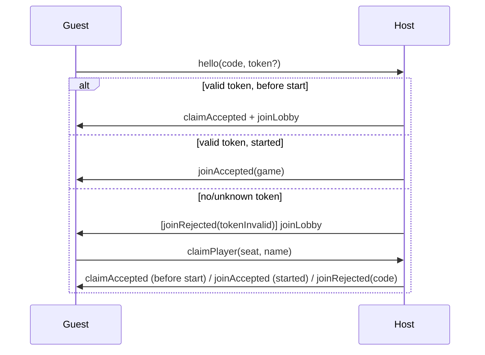
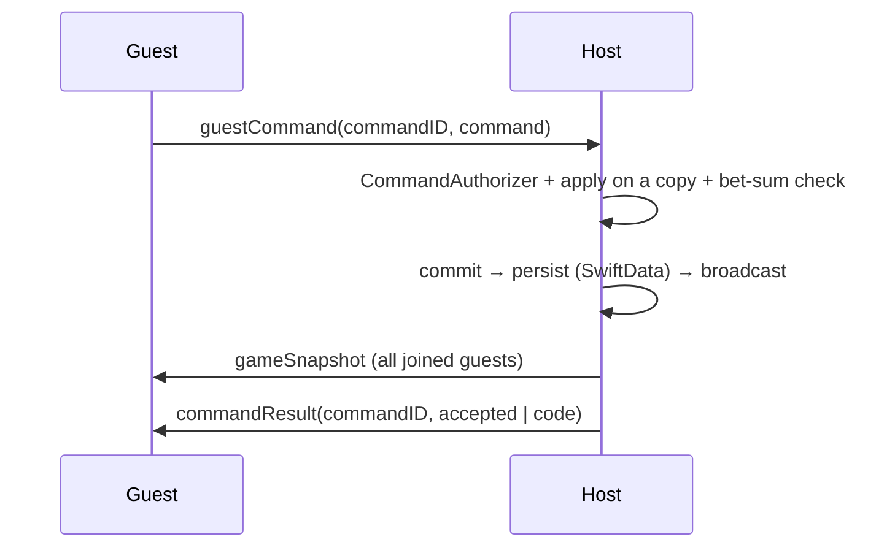

# Wizard Multiplayer — Wire Protocol Reference

`WireProtocolVersion.current` is **2**. Messages are wrapped in `WireEnvelope { version, payload }` and framed as a
4-byte big-endian length + JSON (`FrameCodec` / `FrameDecoder`, max 1 MiB).

## WirePayload cases

| Payload | Direction | Purpose |
|---------|-----------|---------|
| `hello(sessionCode, guestToken?)` | guest → host | First message on every connection (also each reconnect) |
| `joinLobby(gameID, gameName, hasStarted, slots)` | host → guests | Seats; to guests without a seat, and before the start to all joined guests |
| `claimPlayer(playerId?, displayName)` | guest → host | Take a seat (`nil` = first open seat) with a name |
| `claimAccepted(guestToken, playerId, playerName)` | host → guest | Seat taken before the start — persist the token now |
| `joinAccepted(guestToken, playerId, revision, game)` | host → guest | Seat taken / rejoined in a started game, or game start |
| `joinRejected(code, detail?)` | host → guest | Join/claim refused; fatal codes (`versionMismatch`, `sessionNotFound`) close the socket |
| `gameSnapshot(revision, game)` | host → joined guests | After every accepted change |
| `guestCommand(guestToken, commandID, command)` | guest → host | Proposed bet/got |
| `commandResult(commandID?, accepted, code?, detail?, revision?)` | host → guest | Answer (sent after the snapshot) |
| `sessionEnded(code, detail?)` | host → guests | `sessionEnded(hostEnded)`, `sessionEnded(gameFinished)` or `kicked` |
| `leaveSession(guestToken)` | guest → host | Guest leaves for good; host releases the seat |
| `ping` / `pong` | both | Heartbeat (host pings every 5 s; 15 s silence = connection lost) |

`detail` strings are for logs only; the app localizes `code` (`MultiplayerReasonText`).

### LobbyPlayerSlot

`playerId`, `name`, `isHost`, `isBoundToDevice` (token registered, connected or not), `isConnected`,
`isPlaceholderName`; computed `isClaimable` (`!isHost && !isBoundToDevice`).

## Reason codes (`MultiplayerReasonCode`)

| Code | Where | Meaning |
|------|-------|---------|
| `versionMismatch` | joinRejected | Other protocol version — update the app |
| `sessionNotFound` | joinRejected | Wrong session code |
| `seatTaken` / `seatNotFound` | joinRejected | Seat is the host's / bound to a device / no open seat; unknown seat |
| `nameInvalid` / `nameTaken` | joinRejected | Not 1…24 characters after trimming; used by another seat (case-insensitive) |
| `tokenInvalid` | joinRejected | Rejoin token unknown (seat released) — lobby follows |
| `notYourSeat`, `notCurrentRound`, `roundFinalized` | commandResult | Wrong seat / round |
| `betsComplete` / `betsIncomplete` | commandResult | Bet after all bets (or Cloud) / got before all bets |
| `betSumEqualsHandSize(handSize)` | commandResult | Bet-sum house rule (rolled back) |
| `invalidValue`, `gameNotStarted`, `notAuthorized` | commandResult | Range error / lobby / host-only or not joined |
| `sessionEnded(hostEnded \| gameFinished)`, `kicked` | sessionEnded | Session over / seat unassigned |
| `internalError`, `unknown(raw)` | any | Fallbacks (unknown codes from newer peers don't break decoding) |

Encoded as `{"code": "...", "handSize"?: n, "endReason"?: "..."}`.

## Handshake

A guest that gets no answer to `hello` within `SessionTiming.helloReplyTimeout` (8 s) reports
`GuestSessionError.hostIncompatibleOrUnreachable` (a v1 host ignores v2 messages).

## Guest command flow

No answer within `SessionTiming.commandTimeout` (8 s) → `GuestCommandOutcome.timedOut`.

## Mixed versions

- v1 (app 1.1) guest → v2 host: the v1 `hello` decodes; the host answers with a `joinRejected` encoded **exactly** in
  the v1 format (`version: 1`, `{"reason": "<English – German please update>"}`) and closes the connection.
  (App 1.1 logs the reason; its UI shows a generic error.)
- v2 guest → v1 host: the v1 host ignores the v2 `hello` → hello timeout → "host may use an older app version".

## Testing

- `WireProtocolTests` / `FrameDecoderTests` — framing, round trips of every payload, reason codes, v1 format
- `CommandAuthorizerTests` — permission matrix, bet-sum rule
- `SessionSyncTests` — join/claim/snapshot basics
- `SessionLifecycleTests` — heartbeat, reconnect vs. end, rejoin, seats, rollback, atomicity, auto-end, privacy
- `SessionCodeValidationTests` — codes and Bonjour names
- `Tests/WizardAppTests/MultiplayerCoordinatorTests` — persistence, one session, resume, saved guest session

Use `MockHostTransport` / `MockGuestTransport` (`delivery: .mainQueue`, `chunkSize`, `isSilenced`,
`simulateConnectionLoss()`, `nextConnectFailure`, `sentLog`) for tests without real TCP.
